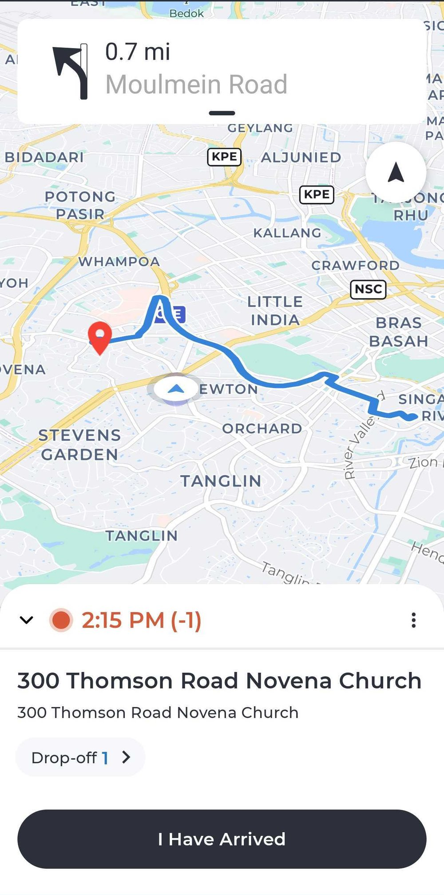

# Maintenance notes

Working notes for [spoonart1.github.io](https://spoonart1.github.io/). See
[README.md](README.md) for the short version.

---

## Files

```
index.html                     the whole page
.nojekyll                      tells GitHub Pages to skip Jekyll
assets/
  css/site.css                 all styles
  Lafran-Pane-CV-2026.pdf      résumé, linked from the page
  img/favicon.svg              tab icon
  img/lafran.jpg               271×271 portrait, used in the header and contact
  img/og.png                   1200×630 share card for LinkedIn, Slack, X
  icons/                       128×128 app icon tiles, one per project
    swat-driver-2.png
    moka-pos.png
    moladin-agent.png          built from Moladin's wordmark, mark cropped out
  shots/                       app screenshots, ~900px wide, EXIF stripped
    swat-driver-2.jpg          navigation, status + gesture bars cropped
    moka-pos.jpg
    moladin-agent.jpg          phone and NIK fields masked
```

---

## A note on the Moladin screenshot

The source graphic shows a financing application with a customer phone number and
a **NIK** — an Indonesian national ID number. The data is placeholder ("John Doe")
and the graphic is public Play Store material, but both identifier fields are
pixelated in the committed file anyway. The field *labels* are left readable, so
the screen still shows what the form captures.

If you ever replace this file, mask those two fields again.

---

## Swapping in real screenshots

The frames are dimension-agnostic. **Any image size or aspect ratio fits** —
a tall phone screenshot, a wide tablet capture, a square crop. The frame keeps a
fixed aspect so the layout never shifts, shows your image whole via
`object-fit: contain`, and fills the leftover space with a blurred, dimmed copy
of the same image. Nothing gets stretched and nothing gets cropped.

**If your replacement keeps the same filename and extension,** just overwrite the
file — no code change at all.

**If the extension differs,** drop it in `assets/shots/` and update the two `src`
attributes for that project in `index.html`. They sit next to each other:

```html
<figure class="shot">
  
  
  <figcaption>Short caption shown under the frame</figcaption>
</figure>
```

Both `src` values point at the same file — one is the blurred backdrop, one is the
image itself. Update the `alt` text on `.shot-img` too; leave `.shot-bg` empty since
it is decorative.

Tips:
- Compress before committing. Aim under ~300&nbsp;KB per screenshot.
- Two or three screenshots stitched side by side in one image works well and reads
  better than a single cramped screen.
- The `<figcaption>` is real copy, not a filename. Say what the screen shows.
- Strip EXIF before committing — phone captures can carry location data. The
  Pillow one-liner in the commit history does the crop, resize and strip together.

## Swapping an app icon

Icons are normalised to 128×128 PNG tiles at build time, so the tile geometry on
the page is identical whatever the source aspect. Overwrite the file in
`assets/icons/` at 128×128 and nothing else needs to change. A non-square source
(Moladin shipped a 730×480 wordmark) needs its mark cropped to roughly square
first, or it will letterbox inside the tile.

## Swapping the portrait

`assets/img/lafran.jpg` is used twice — the header avatar (22px, `.avatar`) and the
contact portrait (7.5rem, `.portrait`). Both are circular and both crop at
`object-position: 50% 25%`, which keeps the face in frame on a head-and-shoulders
source. Overwrite the file with another square image and nothing else changes; a
tighter or looser crop may want that percentage adjusted in `site.css`.

---

## Changing the aspect of the frames

One line in `assets/css/site.css`:

```css
.shot { aspect-ratio: 3 / 4; }   /* portrait-ish, suits phone screenshots */
```

`3 / 4` is taller, `1 / 1` is square, `16 / 10` is landscape. The responsive rules
further down override this on narrow viewports — search for `.shot` to find them.

---

## Regenerating the share card

`assets/img/og.png` is a plain 1200×630 PNG. Edit it in any image tool, or
regenerate it with the Pillow script kept in the commit that added it.
Keep the dimensions — LinkedIn and Slack both expect 1.91:1.

---

## Design notes

Direction is **"5 a.m. dashboard"** — the hour a driver opens a dispatch app.

- **Palette.** Material 3 tonal layering on green-tinted neutrals rather than flat
  black. Two accents only: `--route` (`#4FE0A8`, the nav route line) and
  `--horizon` (`#E8B25C`, the amber behind it). All tokens are at the top of
  `site.css`.
- **Type.** Archivo on its expanded width axis for display, IBM Plex Sans for body,
  IBM Plex Mono for every number and label. Mono numbers are tabular so the
  before/after figures line up.
- **The route track** is the signature device. A dim origin, a lit destination, the
  distance drawn between them. It repeats on every claim, and flexes to say two
  things: *moved* (82% → 99.3%) and *held* (`.vital.held`, for a sustained figure).
  Tracks draw once, on scroll, via one `IntersectionObserver`.
- **Accessibility.** Skip link, visible focus rings, decorative rails hidden from
  screen readers, and `prefers-reduced-motion` renders every track in its final
  state.

---

## Earlier work

Roles before 2018 — games at Agate Jogja, iOS and early Android at Indiva and
Docotel — are summarised in the *Before that* section of the page and detailed in
the [résumé](assets/Lafran-Pane-CV-2026.pdf).
